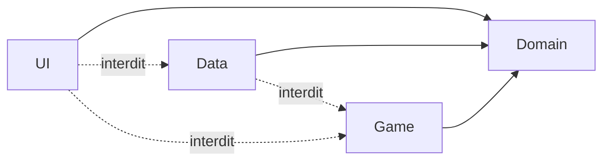
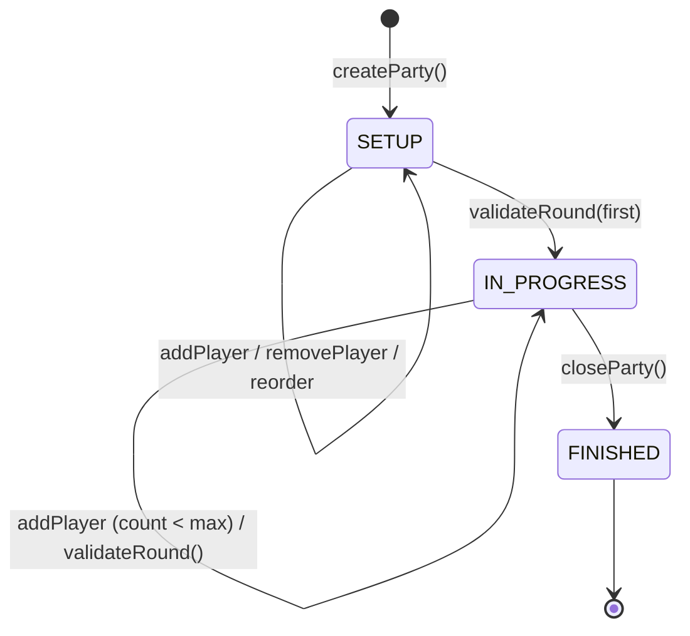
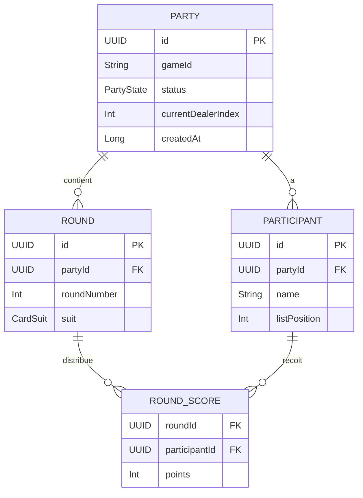

# Architecture Spine — rv-score-counter

## Design Paradigm

**MVVM + Clean Layered** — quatre couches avec règle de dépendance strictement unidirectionnelle vers l'intérieur :

```
UI  →  Domain  ←  Data
            ↑
          Game
```

| Couche | Rôle | Namespace |
|--------|------|-----------|
| `ui` | Composables stateless + ViewModels | `ui/` |
| `domain` | Entités, interfaces, use cases | `domain/` |
| `data` | Room DB, DAOs, Repository impl. | `data/` |
| `game` | Implémentations `GameEngine` par jeu | `game/` |

`UI` et `Data` connaissent `Domain`. `Game` connaît `Domain`. Personne ne connaît `UI`. `Data` et `Game` ne se connaissent pas mutuellement.

---

## Invariants & Rules

### AD-1 — Règle de dépendance inter-couches

- **Binds:** toutes les couches
- **Prevents:** logique métier dans les Composables ; appels Room depuis l'UI ; game logic dans les use cases génériques
- **Rule:** les imports ne traversent jamais la frontière vers l'extérieur. `domain` n'importe rien de `ui`, `data`, ou `game`. `data` n'importe rien de `ui`. `game` n'importe rien de `data` ni de `ui`.



### AD-2 — Contrat GameEngine (extensibilité multi-jeux)

- **Binds:** FR-1, FR-5, FR-6, FR-7, FR-8 ; couches `domain` et `game`
- **Prevents:** deux jeux implémentés différemment dans les use cases ; logique Papayoo codée en dur dans le domain générique
- **Rule:** tout jeu expose exactement l'interface `GameEngine` définie dans `domain/engine/`. Les use cases dépendent de `GameEngine`, jamais d'une implémentation concrète. Chaque jeu vit isolément dans `game/{gameId}/` et n'est connu du reste de l'app que via son `gameId: String` et l'interface.

```kotlin
// domain/engine/GameEngine.kt
interface GameEngine {
    val gameId: String
    val minPlayers: Int
    val maxPlayers: Int
    val totalPointsPerRound: Int          // 250 pour Papayoo
    fun precomputeLastScore(entered: Map<ParticipantId, Int>): Int
    fun validateRound(scores: Map<ParticipantId, Int>): RoundValidation
}
```

### AD-3 — Room, source unique de vérité pour l'état Partie

- **Binds:** FR-16 (reprise), FR-12 (clôture), FR-15 (historique) ; couche `data`
- **Prevents:** état en mémoire divergeant de la base après un kill processus ; perte de Partie non clôturée
- **Rule:** toute mutation de Partie (Round validé, Participant ajouté, clôture) déclenche un write Room **synchrone dans la transaction** avant de retourner au ViewModel. Une Partie non clôturée (`status = IN_PROGRESS`) en base est la définition de "partie à reprendre". Aucun cache mutable en mémoire ne fait autorité sur la base.

### AD-4 — Flux d'état : ViewModel → StateFlow → Composable

- **Binds:** toute la couche `ui`
- **Prevents:** état mutable dispersé dans les Composables ; UI logic non testable
- **Rule:** chaque ViewModel expose un unique `StateFlow<UiState>`. Les Composables sont stateless — ils lisent le `UiState` et émettent des intents (lambdas / sealed `UiEvent`) vers le ViewModel. Aucun `mutableStateOf` dans un Composable si la valeur doit survivre à une recomposition ou à une navigation.

### AD-5 — Machine à états de la Partie

- **Binds:** FR-2, FR-4, FR-12 ; domain + UI
- **Prevents:** règles d'ajout/suppression/réordonnancement appliquées différemment selon les écrans
- **Rule:** `PartyState` est un enum à trois valeurs (`SETUP`, `IN_PROGRESS`, `FINISHED`). Les transitions et les mutations autorisées par état sont définies **uniquement** dans le domain (use cases / `PartyStateMachine`), pas dans l'UI.



### AD-6 — Single Activity + Compose Navigation ; reprise automatique

- **Binds:** FR-16 (reprise), toute la couche `ui/navigation`
- **Prevents:** logique de navigation dupliquée dans les Composables ; état de navigation perdu entre sessions
- **Rule:** une seule `Activity`, un seul `NavHost`. Au lancement de l'app, le `NavGraph` vérifie l'existence d'une Partie `IN_PROGRESS` en base via un use case ; si trouvée, route initiale = `PartyScreen(partyId)`, sinon `HomeScreen`. Les Composables n'appellent jamais `NavController` directement — ils émettent un `NavigationEvent` au ViewModel.

### AD-7 — `CardSuit` enum dans domain ; mapping visuel dans UI

- **Binds:** FR-5, FR-15 ; couches `domain` et `ui/theme`
- **Prevents:** constantes de couleur dans le domain ; enum dupliqué entre couches
- **Rule:** `CardSuit` (SPADE, HEART, CLUB, DIAMOND) est défini dans `domain/model/`. Le mapping `CardSuit → androidx.compose.ui.graphics.Color` vit dans `ui/theme/CardSuitColors.kt`. Aucune référence Compose dans le domain.

### AD-8 — Comptage par Équipe : contrat dédié à côté de `GameEngine` (2026-10-21)

- **Binds:** Epic 7 (Belote) ; couches `domain` et `game`
- **Prevents:** forcer un jeu par Équipe dans le contrat par joueur de AD-2 ; refondre le Papayoo pour un besoin qui ne le concerne pas
- **Rule:** amende AD-2. `GameEngine` reste le contrat par joueur du Papayoo et le catalogue des Jeux. Un jeu par Équipe expose en plus un contrat de domaine qui lui est propre (`BeloteRules` dans `domain/engine/`), implémenté dans `game/{gameId}/`, injecté par un `@Binds` simple et testé en JVM. Ses modèles (`TeamSide`, entrée et résultat de Manche, règle de fin) vivent dans `domain/model/`. Un moteur n'entre dans le catalogue (`@IntoMap`, donc sur l'Accueil) qu'avec sa présentation et son écran de création (Story 7.3), où la part commune de `GameEngine` pour la Belote est fixée.

---

## Consistency Conventions

| Concern | Convention |
|---------|------------|
| Nommage entités | Termes du Glossaire PRD verbatim en anglais : `Party`, `Round`, `Participant`, `RoundScore`, `CardSuit`, `PartyState` |
| Nommage fichiers | `PascalCase` pour classes Kotlin, `snake_case` pour ressources XML/assets |
| IDs | `UUID` (java.util.UUID) pour toutes les clés primaires en base |
| Entités Room | Suffix `Entity` (`PartyEntity`, `RoundEntity`, `ParticipantEntity`, `RoundScoreEntity`) ; les entités domain n'ont pas de suffix |
| DAOs | Un DAO par agrégat racine : `PartyDao`, `RoundDao`, `ParticipantDao` |
| Use cases | Un use case par action métier, nommé verbe + nom : `CreatePartyUseCase`, `ValidateRoundUseCase`, `ClosePartyUseCase`, `ResumePartyUseCase`, `AddParticipantUseCase` |
| UiState | `data class {Screen}UiState(...)` ; jamais de `sealed class` à ce niveau sauf pour les events |
| Erreurs | `Result<T>` (kotlin.Result) en retour des use cases ; l'UI mappe sur des messages utilisateur via des ressources strings |
| Config locale | Français uniquement en V1 ; toutes les strings dans `res/values/strings.xml`, aucune string littérale dans le code |
| Injection | Hilt — modules dans `di/` ; `@HiltViewModel` sur tous les ViewModels |

---

## Stack

[ASSUMPTION : versions à vérifier sur le web avant de commencer l'implémentation.]

| Technologie | Version |
|-------------|---------|
| Kotlin | 2.0.x |
| Android Gradle Plugin | 8.x |
| minSdk | 36 (Android 16) |
| targetSdk | 36 |
| Jetpack Compose BOM | 2025.04.x |
| Compose Navigation | 2.8.x |
| Room | 2.7.x |
| Hilt | 2.52+ |
| ViewModel / Lifecycle | 2.8.x |
| Kotlin Coroutines | 1.9.x |
| Kotlin Serialization | 1.7.x (pour les arguments de navigation typés) |

---

## Structural Seed

### Arbre source

```text
app/src/main/
  java/com/rvetiveau/rvscorecount/
    ui/
      navigation/        # NavGraph, Routes, NavigationEvent
      screens/
        home/            # HomeScreen, HomeViewModel
        setup/           # GameSetupScreen, SetupViewModel
        party/           # PartyScreen, PartyViewModel
        round/           # RoundEntryScreen, RoundViewModel
        results/         # ResultsScreen, ResultsViewModel
        history/         # HistoryScreen, HistoryViewModel, PartyDetailScreen
      theme/             # Theme.kt, Color.kt, CardSuitColors.kt
      components/        # Composables réutilisables (scoreboard, die roller…)
    domain/
      model/             # Party, Round, Participant, RoundScore, CardSuit, PartyState
      engine/            # GameEngine (interface), RoundValidation
      usecase/           # CreateParty, ValidateRound, CloseParty, ResumeParty,
                         #   AddParticipant, RollDie, GetHistory
      repository/        # PartyRepository (interface)
    data/
      db/                # AppDatabase, migration strategy
      entity/            # PartyEntity, RoundEntity, ParticipantEntity, RoundScoreEntity
      dao/               # PartyDao, RoundDao, ParticipantDao
      repository/        # PartyRepositoryImpl
    game/
      papayoo/           # PapayooEngine (implements GameEngine)
      # belote/          # futur — PAS en V1
    di/                  # Hilt modules (DatabaseModule, RepositoryModule, EngineModule)
  res/
    values/strings.xml   # toutes les strings FR
```

### Modèle de données (entités core)



---

## Capability → Architecture Map

| FR / Capacité | Vit dans | Régi par |
|---------------|----------|----------|
| FR-1 Sélection Jeu | `ui/screens/setup` + `domain/usecase/GetAvailableGamesUseCase` | AD-2 (GameEngine registry) |
| FR-2 Ajout Participants | `ui/screens/setup` + `domain/usecase/AddParticipantUseCase` | AD-5 (SETUP state) |
| FR-3 Désignation Donneur | `domain/model/Party.currentDealerIndex` | AD-3 (Room), AD-5 |
| FR-4 Modification liste en cours | `domain/usecase/AddParticipantUseCase` | AD-5 (IN_PROGRESS: ADD only) |
| FR-5 Dé Virtuel + Couleur du 7 | `domain/usecase/RollDieUseCase` + `ui/components/DieRoller` | AD-7 (CardSuit enum) |
| FR-6 Saisie libre scores | `ui/screens/round/RoundViewModel` | AD-4 (StateFlow) |
| FR-7 Pré-remplissage | `domain/engine/GameEngine.precomputeLastScore()` | AD-2 (GameEngine) |
| FR-8 Validation Manche | `domain/usecase/ValidateRoundUseCase` + `GameEngine.validateRound()` | AD-2, AD-3 |
| FR-9 Immuabilité Manche | `data/dao/RoundDao` (INSERT only, no UPDATE) | AD-3 |
| FR-10 Classement temps réel | `ui/screens/party/PartyViewModel` ← `PartyRepository.observeParty()` | AD-4 |
| FR-11 Détail Manches | `ui/screens/history/PartyDetailScreen` | AD-4 |
| FR-12 Clôture Partie | `domain/usecase/ClosePartyUseCase` | AD-3, AD-5 |
| FR-13 Résultats finaux | `ui/screens/results/ResultsScreen` | AD-4 |
| FR-14 Relance rapide | `domain/usecase/CreatePartyUseCase(fromParty=…)` | AD-2, AD-3 |
| FR-15 Historique + Couleur du 7 | `ui/screens/history` + `data/dao/RoundDao` | AD-7 |
| FR-16 Reprise Partie | `AD-6` (NavGraph) + `domain/usecase/ResumePartyUseCase` | AD-3, AD-6 |

---

## Deferred

| Décision | Raison du report | Condition de revisit |
|----------|------------------|----------------------|
| Stratégie de migration Room | Aucune migration requise tant qu'il n'y a qu'une version publiée | Avant toute mise à jour qui change le schéma |
| Ajout de la Belote | Hors périmètre V1 | Quand un second Jeu est initié — créer `game/belote/` + doc jeu spécifique |
| Internationalisation (i18n) | Français uniquement en V1 | Si publication Play Store multi-région envisagée |
| Tests instrumentés (Espresso/UI Automator) | Non requis en V1 usage personnel | Si publication Play Store |
| Thème sombre | Non requis en V1 | Selon feedback post-publication |
| Choix des couleurs exactes CardSuit | Décision UX/design — non bloquante pour l'architecture | Lors de l'implémentation de `CardSuitColors.kt` |
| Stratégie de backup Android (Auto Backup) | Non critique usage personnel | Si publication Play Store, activer/configurer `android:allowBackup` |
| Version API minimale élargie | API 36 couvre l'appareil de l'auteur ; une publication large nécessiterait ~API 26+ | Si publication Play Store envisagée |
